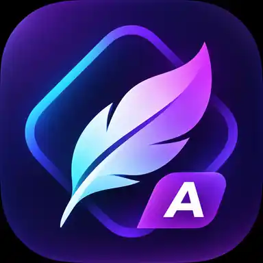

<p align="center">
  
</p>

<h1 align="center">Plume Launcher Advanced</h1>

<p align="center">
  <strong>A personal media hub for Android TV.</strong><br>
  Pick up where you left off. Discover what's new. Open the right app with your remote.
</p>

<p align="center">
  <a href="https://github.com/Justify87/Plume_Launcher/actions/workflows/pr.yml"></a>
  <a href="https://github.com/Justify87/Plume_Launcher/actions/workflows/debug-apk.yml"></a>
  
  <a href="LICENSE"></a>
</p>

> [!IMPORTANT]
> **This is an independent, actively developed fork of [Plume Launcher by aradhyas8](https://github.com/aradhyas8/Plume_Launcher), maintained by [Justify87](https://github.com/Justify87).** It is not the original Plume release, an official successor, or affiliated with the original maintainer. Original authorship and the GPL-3.0 license are acknowledged [below](#origin-credits-and-license).

## Why this fork exists

Plume Launcher Advanced is an experiment in making the TV home screen **useful without making it busy**.

A conventional launcher mostly answers *“Which app do you want to open?”* This fork is built toward a second question: *“What were you watching or listening to, and what is worth coming back for?”*

The long-term direction is a **single, remote-friendly overview** of recent and newly available content, followed by dedicated entry points for individual apps. Think episodes, movies, YouTube videos and podcast listening progress—**where the respective app or system actually makes that data accessible**. The goal is to reduce the steps between turning on the TV and getting back into something good.

This is a **personal hobby fork**, not a promise of commercial-grade integrations or support for every streaming service. It retains Plume's lightweight design philosophy while exploring a more content-centered home experience.

### Design principles

- **One TV home, not competing layouts.** The V-Design is the only launcher Home surface; Classic and the older Overview mode were removed in M06.
- **Content from real publishers.** The three V-Design sections use the Nuvio TV Preview channels `:in-progress`, `:available`, `:upcoming` — never manufactured titles or sample shows.
- **D-pad first.** The launcher, source apps, All Apps, system actions and Settings must remain reachable from the remote.
- **No provider assumptions.** Permission denied, missing channel and offline conditions show honest empty states instead of fake items.
- **Respect existing Android and VPN capabilities.** Keep TV inputs, Home-role setup, wallpaper and the original embedded Mullvad backend.

## Where things stand

The active design work is tracked in [draft PR #46](https://github.com/Justify87/Plume_Launcher/pull/46).
The single V-Design Home has existed on `main` since PR #39, but **its old
appearance is no longer normative**. The screenshot supplied on 15 November
2026 is the exclusive visual reference for the redesign.

- **Home:** slim icon-only rail; 1 featured Nuvio Continue card + 2 secondary
  cards; three available-episode entries at right; six upcoming episodes in
  a single horizontal strip; real date, time, and a conservatively verified
  Android VPN-transport indicator.
- **Apps and settings:** installed Nuvio, SmartTube and Spotify shortcuts,
  All Apps, integrated Mullvad and compact native Launcher Settings.
- **Mullvad:** original tunnel/account/server repositories, VpnService,
  Rust/JNI and routing remain unchanged; the TV shell and subpages share
  the new dark expressive styling.

**Do not treat the older V-Design screenshots, 14-slot grid, five-tab
sidebar, M00–M08 milestones or original Plume contribution restrictions
as active product/design requirements.** The current contract is
[Design Contract](docs/v-design/DESIGN_CONTRACT.md) and
[Contributing](CONTRIBUTING.md).

The new visual design still needs green integrated CI and physical Shield
TV visual/interaction checks. Screenshots, pixel-match and device validation
are not implied by source edits.

## Design and navigation

The target is the image-based **1536×864 editorial layout**: matte charcoal,
lime active focus/progress, lavender/peach pills, asymmetrical cards and
compact settings menus. Image assets displayed inside media cards are dynamic
Nuvio media, not hardcoded illustrations or titles.

Use the D-Pad to select a rail icon, then Right to enter content. The
sidebar includes a visible All Apps entry, plus long-OK on Home (All Apps)
and on Settings (System/HDMI/Power actions). Back/Home and focus restore
remain supported. If the data source is empty, no demonstration content
is inserted.

**UI technology is intentionally open.** The existing Kotlin/Android
Views/XML implementation is currently convenient, but well-maintained
AndroidX/Material libraries, animation libraries or a selective Compose
migration are acceptable when they measurably improve appearance and
TV navigation at reasonable cost.

## Install a debug APK

**Requirements:** Android TV or Google TV on **Android 8.0 (API 26) or later**. Compatibility and Home-button behavior vary by TV. The **NVIDIA Shield TV Pro (2019)** is a primary target for this fork, but this README does not imply that every change has been verified on physical hardware.

There is a manual GitHub Actions build for installing and testing the latest code:

1. Open **[Build Plume Launcher Advanced Debug APK](https://github.com/Justify87/Plume_Launcher/actions/workflows/debug-apk.yml)**.
2. Select **Run workflow**, choose `main` and start the build.
3. Open the successful run. Under **Artifacts**, download the `Plume-Launcher-Advanced-Debug-APK-…` ZIP.
4. Extract `Plume-Launcher-Advanced-debug.apk` and install it on the TV using a file manager, USB transfer or ADB.

For ADB installation:

```bash
adb install Plume-Launcher-Advanced-debug.apk
```

The workflow runs unit tests and lint, assembles the APK and verifies that its Android package is `dev.plume.advanced` and its label is **Plume Launcher Advanced**. It also provides a SHA-256 checksum. **A workflow artifact is a test build, not a published release.**

> [!NOTE]
> GitHub-hosted debug builds may be signed with different debug keys between runs. If Android rejects a later debug APK because its signature differs, you may need to uninstall the earlier **Advanced** build and reinstall. **Back up your Advanced settings first**; uninstalling removes that app's local data. Do not uninstall original Plume by mistake.

### Run both launchers side by side

| | Original Plume | Plume Launcher Advanced |
| --- | --- | --- |
| Android application ID | `dev.plume` | `dev.plume.advanced` |
| Installed app and icon | Original branding | Separate name and feather-and-A icon |
| Settings and app data | Original app's storage | Independent Advanced storage |
| Updates | Original project's releases | This fork's releases only |

Both apps can be installed at the same time. **Only one should control the Home button at a time.** If the original's accessibility Home service is enabled, disable it before enabling the Advanced service. Otherwise the services may compete.

When you first open Advanced, follow its Home setup. On supported Android TV devices, choose Advanced as your Home app. On Google TV, the optional **Plume Launcher Advanced: Home button** accessibility service is used where the stock launcher retains Home control. **Do not disable the stock Google TV launcher**: doing so can break the device.

If the TV blocks restricted settings for sideloaded apps, consult Android's app settings first. An advanced ADB setup may require:

```bash
adb shell pm grant dev.plume.advanced android.permission.WRITE_SECURE_SETTINGS
```

This is a privileged system-setting grant, **not** part of normal APK installation. Grant it only if you understand the effect and need the associated Home / screensaver functions. An interactive setup helper is provided at [tools/plume-install.sh](tools/plume-install.sh); run it without `--disable-stock-launcher` unless you deliberately accept the device-specific risks.

## Settings and data

Advanced stores its preferences separately from the original app. **An installation does not migrate Plume's settings automatically.**

Advanced supports a selective backup in **Settings → Backup → Save backup / Restore backup**. On many devices, the resulting file is located at:

```text
/sdcard/Android/media/dev.plume.advanced/backup/plume-advanced-settings.json
```

The export covers supported display and layout preferences, **not** everything. It does not copy the PIN, all media files, custom app picture files, system Home selection, remote mappings or permissions. Treat exported files as personal data if they include your configured location or application list.

## Build from source

The current code uses **Kotlin, Android Views/XML and Android TV framework APIs**. This is not a ban on modern UI technology: a justified AndroidX/Material dependency, custom view system, or selective Compose migration is acceptable if it preserves TV performance and the integrated Mullvad build.

Requirements: **JDK 17**, an installed Android SDK for the project's configured compile SDK, and a working Gradle wrapper.

```bash
git clone https://github.com/Justify87/Plume_Launcher.git
cd Plume_Launcher
./gradlew testDebugUnitTest lintDebug assembleDebug
```

Local output: `app/build/outputs/apk/debug/app-debug.apk`. The manual GitHub Actions workflow renames the uploaded APK to `Plume-Launcher-Advanced-debug.apk`.

Useful starting points in the code:

| File | Purpose |
| --- | --- |
| [MainActivity.kt](app/src/main/java/dev/plume/MainActivity.kt) | Launcher activity and established navigation/settings behavior |
| [VDesignHomeView.kt](app/src/main/java/dev/plume/VDesignHomeView.kt) | The only Home renderer and sidebar/navigation shell |
| [VDesignFocusNavigator.kt](app/src/main/java/dev/plume/VDesignFocusNavigator.kt) | Spatial D-pad navigation |
| [VDesignCardView.kt](app/src/main/java/dev/plume/VDesignCardView.kt) | Real Nuvio media-card presentation |
| [AndroidTvMediaSource.kt](app/src/main/java/dev/plume/AndroidTvMediaSource.kt) | TV Preview channel and Nuvio source interpretation |
| [SettingsTransfer.kt](app/src/main/java/dev/plume/SettingsTransfer.kt) | Selective settings backup/restore |
| [HomeOverride.kt](app/src/main/java/dev/plume/HomeOverride.kt) | Optional Home-button accessibility integration |

The **Kotlin namespace remains `dev.plume`** to avoid an unnecessary source-wide refactor. Android identifies the separately installable app by its **application ID `dev.plume.advanced`**.

CI runs pull request checks, unit tests, lint, APK assembly and installation-helper regression tests. Hardware and remote-control behavior still deserve hands-on validation.

## Privacy and network access

The goal is to keep the home experience **ad-free, account-free and free of analytics**. The fork does not need a central tracking account to show its existing UI, and its Home reads only supported Nuvio TV Preview channels. Other optional source integrations and network features remain separate.

The underlying launcher can still make network requests for **selected** wallpapers and videos, weather/location-related data, poster images and GitHub update checks. Network services that supply such content can receive normal connection information such as the device's IP address. Permissions may be needed to read Android TV listings or user-selected images. The optional accessibility service is for Home and configured remote-key behavior, **not** a general-purpose media-history scraper.

Future integrations should be evaluated individually for availability, consent, reliability and privacy. **Android TV and optional public YouTube feeds are real sources; Spotify account integration is not shipped.**

## Updates and project status

- **Current testing distribution:** build a debug APK using the manual GitHub Actions workflow.
- **In-app update checks:** look at **[releases in this fork](https://github.com/Justify87/Plume_Launcher/releases)**, not upstream. A future release must use the expected `Plume-Launcher-Advanced.apk` asset name for the current updater.
- **Breaking changes and progress:** see [CHANGELOG.md](CHANGELOG.md) and merged PRs.
- **Support:** use [this fork's issues](https://github.com/Justify87/Plume_Launcher/issues). Issues with the unmodified original should go to the original project.

The project is experimental and evolves in small milestones. There is no guaranteed release cadence, app-service compatibility list or production support commitment.

## Origin, credits and license

**Plume Launcher Advanced is based on [Plume Launcher](https://github.com/aradhyas8/Plume_Launcher), originally created by [aradhyas8](https://github.com/aradhyas8).** The original project provided the foundation: its launcher, existing features, UI concepts, Android TV integration and a large part of the codebase. **Thank you to the original author and contributors.**

This fork is maintained by **[Justify87](https://github.com/Justify87)**. Its separate identity, Advanced UI prototype, further changes and new branding do **not** transfer ownership of upstream contributions or imply endorsement by the original maintainer. The Git history preserves the project's origins; upstream copyright notices remain applicable.

Other resources or inspirations used in the inherited codebase include:

- [AerialViews](https://github.com/theothernt/AerialViews) for aerial video source data; Apple, Amazon and NASA remain the respective sources of their media.
- [Google Material Symbols](https://fonts.google.com/icons) for applicable UI symbols (Apache 2.0).
- [Simple Icons](https://simpleicons.org/) for applicable app/service marks (CC0 where provided; trademarks remain with their owners).
- Public-domain artwork sourced through Wikimedia Commons for the inherited Gallery screensaver.

The **Advanced feather-and-A launcher artwork** was created for this fork. The existence of third-party app names, marks and media references does not imply partnership or affiliation.

### License

This repository is distributed under the **[GNU General Public License, version 3](LICENSE)**, consistent with its upstream source. Modifications must preserve the relevant licensing, source-availability and attribution obligations when redistributed. See the repository's [LICENSE](LICENSE) and file-level notices for details.

**Original project:** https://github.com/aradhyas8/Plume_Launcher  
**This fork:** https://github.com/Justify87/Plume_Launcher

---

<p align="center"><sub>Plume Launcher Advanced · Built on Plume, evolving toward a simpler way to resume and discover media on TV.</sub></p>
