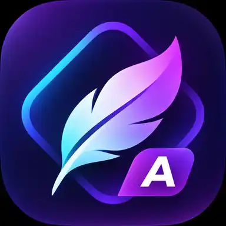

<p align="center">
  
</p>

<h1 align="center">Plume Launcher Advanced</h1>

<p align="center">
  <em>A distinct Plume fork.</em> A minimal, ad-free home screen for Android TV and Google TV.
</p>

<p align="center">
  <a href="https://github.com/Justify87/Plume_Launcher/actions/workflows/debug-apk.yml"></a>
  
  <a href="LICENSE"></a>
</p>

**Plume Launcher Advanced is an independently installable fork of [Plume Launcher](https://github.com/aradhyas8/Plume_Launcher).** Its Android app ID is `dev.plume.advanced`, not `dev.plume`: both apps can be installed side by side, with their own app data, Home button service and settings. Its launcher icon and TV banner are different. To create a debug APK, run the [manual build workflow](https://github.com/Justify87/Plume_Launcher/actions/workflows/debug-apk.yml) and download `Plume-Launcher-Advanced-debug.apk` from the run's Artifacts. Do not expect settings to migrate automatically. Only enable one launcher's accessibility Home service at a time.

**Updates:** This fork checks **this repository**, not upstream, for future releases. Publish a versioned release with an asset named `Plume-Launcher-Advanced.apk` to enable in-app updates. Debug APKs from Actions do not count as releases.


<p align="center">
  
</p>

<p align="center"><em>Forest Mist · Dark theme · Frosted glass</em></p>

<table>
  <tr>
    <td width="50%" align="center">
      
      <br>
      <em>Alpine Dawn · Light theme · Frosted glass</em>
    </td>
    <td width="50%" align="center">
      
      <br>
      <em>Moonlit Ridge · Dark theme · Clear glass</em>
    </td>
  </tr>
</table>

Plume Launcher Advanced replaces the cluttered stock home screen with the two things you actually use: your apps and what you were watching. No ads, no sponsored rows, no account and no tracking.

## Highlights

- **Glass design.** Tiles, cards and settings in **Clear** or **Frosted** glass, or solid. The selected tile rises out of its row and its edge catches the light. Text and icons change colour to stay readable on any wallpaper.

  <p align="center">
    
  </p>
- **Live wallpapers and Aerial Views, built in.** 250+ Apple, Amazon and NASA scenes as your wallpaper or screensaver, or your own MP4. Each scene downloads once, only when you pick it.
- **Wallpapers your way.** Built-in photos, an optional 4K pack, Bing's photo of the day, pictures of your shows, a photo folder or USB drive, or photos sent from your phone by QR code. The **Wallpaper** theme picks light or dark from the picture.
- **Continue Watching** from Android TV's Watch Next list and from apps with their own channel, such as Stremio and Nuvio.
- **Clean apps row.** Monochrome logos, colour logos or banners in three sizes. Rearrange, hide, or sort by most used. A PIN keeps the layout safe from small hands.
- **Home button on Google TV**, even where the stock launcher can't be replaced. Holding Home still opens the Google TV dashboard.
- **Remote keys and Sources.** Remap the TV, Netflix or Settings button, with a separate action on hold. Switch HDMI inputs from the top bar.
- **Tiny and fast.** A 0.4 MB APK with no third-party libraries and no background services. It updates itself from GitHub.

## How it compares

Measured on a Hisense Google TV (Android 12, 1.8 GB RAM):

| | Plume Launcher Advanced | Projectivy Launcher | Google TV launcher |
|---|---|---|---|
| APK size | **0.4 MB** | ~10–14 MB | ~25 MB |
| RAM while running | **~50–70 MB** | ~65–70 MB | ~93 MB, plus a ~22 MB helper process |
| Extra background services | **None** | 2 | 1 always-on helper |
| Return to home from an app | **~95 ms** | – | – |

## Install

You need Android TV or Google TV on **Android 8.0 or newer**.

1. Open [Build Plume Launcher Advanced Debug APK](https://github.com/Justify87/Plume_Launcher/actions/workflows/debug-apk.yml) in GitHub Actions, select **Run workflow** on `main`, and open the completed run.
2. Download the ZIP under **Artifacts** and extract **`Plume-Launcher-Advanced-debug.apk`**.
3. Install it on the TV using a USB drive or `adb install Plume-Launcher-Advanced-debug.apk`. **Do not download the APK from the upstream Plume releases**, because that is a different app.
4. Open **Plume Launcher Advanced** from your apps. Its settings opens and shows a **Finish setup** card.
5. Allow the **TV listings** permission when asked. Continue Watching needs it.
6. Make the Home button open Plume Launcher Advanced. Find your TV below.

### Make Home open Plume Launcher Advanced

| Your TV | What to do |
|---|---|
| **Google TV / Android TV** | **Plume Launcher Advanced settings → Home & remote → Home opens Plume Launcher Advanced**, then turn on **Plume Launcher Advanced: Home button** in Accessibility. Or choose Plume Launcher Advanced as the **Home app**. |
| **Android 13+, switch greyed out** | Unlock it once over adb. See [Android 13 and newer](#android-13-and-newer). |
| **Fire TV** | The Home button service covers Amazon's home with Plume Launcher Advanced. See [Fire TV](#fire-tv). |
| **Any TV, from a computer** | Run [`tools/plume-install.sh`](tools/plume-install.sh). See [Set up over adb](#set-up-over-adb). |
| **Other tools** | A launcher app such as **Launcher Manager**, or `adb shell pm disable-user` on the stock launcher. |

> [!WARNING]
> **Do not disable the stock launcher.** On many TVs this breaks setup screens, input switching or the boot itself, and some TVs then need a factory reset. Use the Home button service instead. `plume-install.sh --disable-stock-launcher` is the only safe path, works on Fire TV only, and can undo itself.

<details>
<summary><b>Android 13 and newer</b></summary>

#### Android 13 and newer

Android 13+ greys out the Accessibility switch for sideloaded apps, and most Google TV builds hide **Allow restricted settings**. If your TV shows that menu, use it: **Settings → Apps → Plume Launcher Advanced → ⋮ → Allow restricted settings**. If not, unlock it once from a computer or a phone adb app on the same network:

1. **Settings → System → About**: press **Android TV OS build** seven times.
2. **Settings → System → Developer options**: turn on **Network debugging** (**USB debugging** on some TVs).
3. Run, with the address Plume Launcher Advanced shows:

   ```sh
   adb connect <tv-address>:5555
   adb shell pm grant dev.plume.advanced android.permission.WRITE_SECURE_SETTINGS
   ```

4. Accept the prompt on the TV, then choose **Try again** in Plume Launcher Advanced. Plume Launcher Advanced turns the service on by itself.

The same grant also lets Plume Launcher Advanced set the Gallery screensaver and turn its Home service back on after a force-stop. Everything else works without it.
</details>

<details>
<summary><b>Fire TV</b></summary>

#### Fire TV

Fire OS never gives the Home key to apps. The Home button service watches for Amazon's home and covers it with Plume Launcher Advanced. Limits:

- **On Fire OS 7, Plume Launcher Advanced shows about 5 seconds after Home.** Android holds back app starts for 5 seconds after Home. See [#153](../../issues/153).
- **Amazon's Network status screen opens with no highlighted button** while the service is on. Press Down until **Advanced** is highlighted, or turn the service off for a moment.
- **Remote keys can't be set.** Fire OS doesn't pass the keys to Plume Launcher Advanced.

If Home doesn't reach Plume Launcher Advanced, run [`tools/plume-firetv-probe.sh`](tools/plume-firetv-probe.sh) and post the result in [#153](../../issues/153).
</details>

<details>
<summary><b>Set up over adb</b></summary>

#### Set up over adb

Turn on adb debugging on the TV, then from a computer on the same network:

```sh
./plume-install.sh 192.168.1.20      # add -a plume.apk to install Plume Launcher Advanced first; -n shows the plan only
```

The script detects the TV (Fire OS version, Google TV or Android TV), shows what it will change and asks first. It grants `WRITE_SECURE_SETTINGS`, turns on the Home button service and checks each change on the TV. It writes each change to a recovery record (`/data/local/tmp/plume-install.state`) before it makes it. `./plume-install.sh --undo` reverts only what the script changed; it does not uninstall Plume Launcher Advanced.

Tests run against a fake `adb`, no TV needed: `sh tools/plume-install-test/run.sh`.
</details>

<details>
<summary><b>Volume and the accessibility warning</b></summary>

- **Holding Volume moves one step?** Many TVs act on the volume keys before an accessibility service sees them. Turn on **Plume Launcher Advanced settings → Home & remote → Smooth volume**. In exchange, Home shows Google TV for about a second first. Smooth volume stays off while any Remote keys are set.
- Android shows the same generic warning for every accessibility service. Plume Launcher Advanced's service listens for the Home key, your Remote keys and the stock launcher appearing. It cannot read screen content.
</details>

## Using Plume Launcher Advanced

| To | Do this |
|---|---|
| Rearrange apps | Hold **OK** on an app, or **Plume Launcher Advanced settings → Apps row → Rearrange apps** |
| Remove an app from the row | Hold **OK** on it, then **Remove from row**. It stays in **All apps**. |
| Pin an app from All apps | Open **All apps** and hold **OK** on the app |
| Hide a Continue Watching card | Hold **OK** on it, then **Remove from Continue Watching** |
| Change glass, theme or wallpaper | **Plume Launcher Advanced settings → Style** |
| Change app size, icon style or names | **Plume Launcher Advanced settings → Apps row → Size**, **Icon style** or **App names** |
| Change an app picture | Hold **OK** on the app → **Change picture** → **Icon** or **Banner**. Upload from your phone. |
| Choose apps for Continue Watching | **Plume Launcher Advanced settings → Shows row → From apps** |
| Change the clock | **Plume Launcher Advanced settings → Clock & weather → Clock style** or **Clock size** |
| Move, hide or add a top-bar icon | Hold **OK** on the icon, then **Move**, **Hide** or **Add icon** |
| Remap a remote key | **Plume Launcher Advanced settings → Home & remote → Remote keys → Add a key**, then press it |
| Lock the layout | **Plume Launcher Advanced settings → PIN lock**. Forgot the PIN? **Android Settings → Apps → Plume Launcher Advanced → Clear data**. |
| Update Plume Launcher Advanced | **Plume Launcher Advanced settings → Updates** |
| Open the Google TV dashboard | Hold **Home** |

Custom pictures change only the home row. Icons use the Monochrome and Colour styles; banners use the banner styles.
Upload a PNG, JPEG or WebP file up to 5 MB. Select **Reset picture** to restore the original icon and banner.

<p align="center">
  <br>
  <em>Largest app size</em>
</p>

Remote keys can open an app or input, send a media key, or open Back, Recent apps, Notifications, Quick settings, the Power menu or Android settings. Back, OK, the arrows, Home, Power and volume can't be changed, so you can't lock yourself out. The PIN lock keeps the layout safe; it is not parental control.

Select **Plume Launcher Advanced All apps** as the Press or Hold action under **Home &amp; remote → Remote keys**.

## Wallpapers and screensavers

<p align="center">
  
  
</p>

- **Live wallpapers:** **Plume Launcher Advanced settings → Style → Wallpaper → Live wallpapers**. Browse [Apple Aerial](https://github.com/theothernt/AerialViews/blob/master/app/src/main/res/raw/tvos26.json) (139), [Amazon Fire TV](https://github.com/theothernt/AerialViews/blob/master/app/src/main/res/raw/fireos8.json) (112) and [NASA](https://svs.gsfc.nasa.gov/4019) (4) scenes, or **Surprise me**. **Add your video from phone…** takes an H.264 or HEVC MP4 up to 1080p and 350 MB. Videos play muted and stop when you leave Home.
- **Your photos:** **Add from phone…** shows a QR code. Scan it on the same Wi-Fi and upload. Or pick **Choose a folder on this TV…** for a folder or USB drive that rotates on a timer. Or copy files over adb:

  ```sh
  adb push my-wallpaper.jpg /sdcard/Android/data/dev.plume.advanced/files/wallpapers/
  ```

- **Aerial Views screensaver:** **Plume Launcher Advanced settings → Screensaver → Screensaver → Aerial Views**. It uses the scenes you downloaded for the wallpaper, so nothing downloads twice. Press ◀ or ▶ to skip.
- **Gallery screensaver:** public-domain landscape paintings (4.7 MB), downloaded only while you use it.

Plume Launcher Advanced shows every wallpaper as it is, with no dark fades on top.

## Transfer settings

Open **Plume Launcher Advanced settings → Backup → Save backup**. Plume Launcher Advanced shows the file path after saving.
Saving replaces the previous backup file.
Copy the file off the TV before uninstalling Plume Launcher Advanced. Uninstall removes the app's backup folder.

The usual path is `/sdcard/Android/media/dev.plume.advanced/backup/plume-advanced-settings.json`:

```sh
adb pull /sdcard/Android/media/dev.plume.advanced/backup/plume-advanced-settings.json
```

On the destination TV, install and open Plume Launcher Advanced, then copy the file:

```sh
adb shell mkdir -p /sdcard/Android/media/dev.plume.advanced/backup
adb push plume-advanced-settings.json /sdcard/Android/media/dev.plume.advanced/backup/plume-advanced-settings.json
```

Select **Plume Launcher Advanced settings → Backup → Restore backup** and confirm. Plume Launcher Advanced reloads the home screen.
The file transfers theme, glass, icon style, layout, clock, weather, app order, hidden apps, and photo timing.
Custom app pictures stay on this TV. Settings backups do not include picture files.
Missing supported settings return to their defaults. Unknown settings are ignored.
An unsupported file version or invalid supported value stops the import before settings change.

The JSON envelope uses this format. String sets use JSON arrays.

```json
{"format":"plume-settings","version":1,"settings":{"theme":"dark","row_hidden":["com.example.app"]}}
```

The PIN, setup state, wallpapers, photo folders, HDMI inputs, remote mappings, usage history, and system settings stay local.
This includes Home permissions and screensaver timing. App order applies to apps installed on the destination TV.
The file can contain the manual weather location. Keep the exported file private.

## Privacy

Plume Launcher Advanced has no analytics, no ads and no account. It only connects to the internet to:
- load poster images for your Continue Watching items
- check this repository's GitHub releases for a new version, once a day, and download it when you choose to update
- download the Gallery paintings from this repository, **only if you choose that screensaver**
- check this repository for wallpapers **when you open Built-in**. Plume Launcher Advanced updates photos you already downloaded. New photos download only when you select them.
- get the Bing picture of the day (about 300 KB), **only if you choose it as your wallpaper**. Plume Launcher Advanced sends a request to [bing.com](https://www.bing.com) when the home screen opens: once a day, or once an hour until the picture has changed that day. Bing sees the TV's IP address and its language and country. Plume Launcher Advanced keeps one picture and deletes it when you choose another wallpaper.
- download one NASA Earth video from [svs.gsfc.nasa.gov](https://svs.gsfc.nasa.gov/4019), **only when you select that scene**. NASA sees the TV's IP address.
- download an Apple Aerial video from [sylvan.apple.com](https://sylvan.apple.com) or an Amazon Fire TV video from [Amazon's Fire TV CDN](https://aebcs-cdn-prod-na.services.firetv.amazon.dev), **only when you select that scene**. The source sees the TV's IP address.
- fetch the weather, **only if you turn it on**. It looks up your approximate location from your IP address via [ipwho.is](https://ipwho.is), then gets the forecast from [Open-Meteo](https://open-meteo.com). The Auto theme uses the same location for sunrise and sunset, with no extra request. Clearing Plume Launcher Advanced's data removes it.

**Add from phone…** and **Change picture** run an upload page on the TV.
The page works only on your home network while its screen stays open.
Photos and videos go straight from your phone to the TV and nowhere else.

## Troubleshooting

<details>
<summary><b>The Home button still opens the old home screen</b></summary>

Check that **Plume Launcher Advanced settings → Home & remote → Home opens Plume Launcher Advanced** shows **On**. If the app was force-stopped, Android turns its accessibility service off; open Plume Launcher Advanced once (or grant the optional adb permission above) to restore it.
</details>

<details>
<summary><b>Continue Watching is empty</b></summary>

Make sure the TV listings permission is allowed (**Settings → Apps → Plume Launcher Advanced → Permissions**), and that the app you watch publishes to Android TV's Watch Next list. Check **Plume Launcher Advanced settings → Shows row → From apps** too.
</details>

<details>
<summary><b>The screensaver option says it needs an adb permission</b></summary>

Google TV hides third-party screensavers from its own settings, so Plume Launcher Advanced needs the one-time `WRITE_SECURE_SETTINGS` grant shown above to switch it for you.
</details>

## Building from source

```sh
git clone https://github.com/Justify87/Plume_Launcher.git
cd Plume_Launcher
./gradlew assembleRelease
```

The APK is written to `app/build/outputs/apk/release/`. Without a `keystore.properties` file, release builds are signed with your local debug key, which is fine for installing your own build.

## Contributing

Bug reports, design ideas, translations and pull requests are welcome. Plume Launcher Advanced stays small on purpose, so please read [CONTRIBUTING.md](CONTRIBUTING.md) first: it lists what's in and out of scope and how to send a change. Open an issue before starting on a feature.

## Credits

- **Screensaver paintings** (public domain, scans via Wikimedia Commons; files in [`screensaver/`](screensaver)):
  - Frederic Edwin Church: *The Heart of the Andes*, *The Icebergs*, *Chimborazo*, *Cotopaxi*
  - Ivan Shishkin: *Rye*
  - Jasper Francis Cropsey: *Autumn on the Hudson River*
  - Martin Johnson Heade: *Thunder Storm on Narragansett Bay*
- **Wallpaper pack:** ten 3840 × 2160 WebP images in [`wallpapers/`](wallpapers), available as an optional 14.9 MB download: Alpine Dawn, Forest Mist, Coastal Dusk, Autumn Canopy, Arctic Aurora, Sand Dunes, Aerial River, Ocean Reef, Cherry Blossom, and Moonlit Ridge.
- **Aerial Views:** the Apple Aerial scene list comes from the [Aerial Views](https://github.com/theothernt/AerialViews) project (GPL-3.0). Plume's Aerial Views screensaver is not part of that app. NASA scenes: NASA Goddard Space Flight Center Scientific Visualization Studio and Earth Observatory.
- **App logos:** [Simple Icons](https://simpleicons.org) (CC0). All trademarks belong to their respective owners.
- **HDMI input and settings icons:** [Material Symbols](https://fonts.google.com/icons) by Google (Apache 2.0)

## License

Copyright (C) 2026 aradhyas8

Plume Launcher is free software, released under the [GNU General Public License v3.0](LICENSE). You may use, modify and redistribute it, but any distributed version, modified or not, must also be released under the GPL-3.0 with its full source code.
